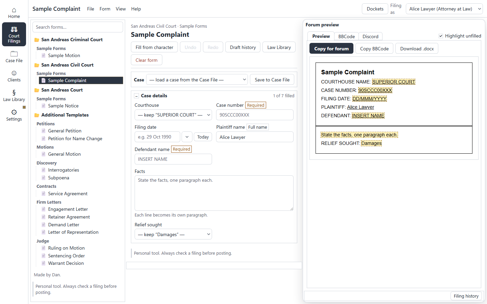
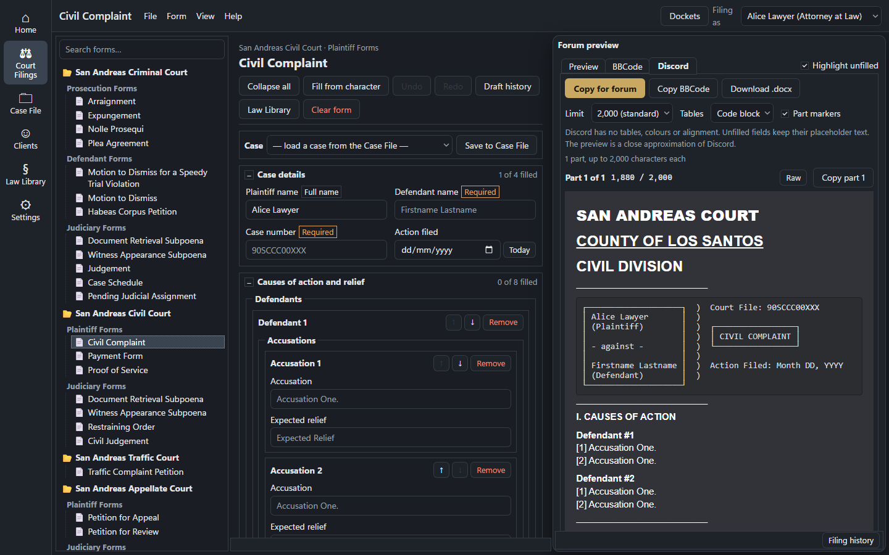

# Court Filing Generator

[](https://github.com/danieljcode/lawportal-v2/actions/workflows/ci.yml)

A personal, local web app for writing San Andreas court filings. Pick a form, fill in the fields, and
copy the finished filing straight into a forum editor (as formatted HTML or as BBCode), or download it
as a Word `.docx`.

It carries 39 court forms plus six of our own templates (petitions, a motion, discovery and a
contract), and it looks like a 1990s Windows desktop.

> Personal tool. These are roleplay court forms, not legal documents. Always check a filing before
> posting.





## Running it

```bash
npm install
npm run dev
```

Then open http://localhost:3000. For a production build:

```bash
npm run build
npm start
```

Both bind to `127.0.0.1`, so only this computer can reach the app.

### Other devices on your network

```bash
npm run build && npm run start:lan
```

This binds to `0.0.0.0` and prints `LAN mode: the app and its sync API are reachable from your network.`
Open `http://<this computer's LAN IP>:3000` on the other device. Notes:

- For other devices prefer `npm run build && npm run start:lan`. `npm run dev:lan` works too, but
  `next dev` warns about cross-origin dev requests from other devices.
- Copy uses a fallback over plain http on the LAN: `http://<LAN IP>` isn't a secure context, so the
  browser's clipboard API is unavailable and the app copies through a text selection instead.
- Without a `:lan` script, every API request that doesn't arrive on `localhost`/`127.0.0.1` gets
  `421`. This also blocks DNS-rebinding pages from reaching the local API.

## Features

- **Form catalogue.** 39 court forms in their court groups (Criminal, Civil, Traffic, Appellate,
  Supreme, Miscellaneous, Small Claims), then **Additional Templates**: General Petition, Petition for
  Name Change, General Motion, Interrogatories, Subpoena and Service Agreement.
- **Sidebar.** Search by title, court or section; collapsible court groups with section labels; a
  Court Commissioners group with the J.A.P. when a commissioner is the active character.
- **Start page** with the three steps (add your character, fill in the form, copy for forum).
- **Form editor.** Inputs generated from the template: collapsible sections with "x of y filled"
  counts, checkbox lists with inline details, repeatable items (add, remove, reorder), optional
  sections, dates with Today/Auto. Case number boxes start empty and show the pattern as a
  placeholder: in-game year, courthouse, division and number, e.g. `90SCCR00XXX` (Superior Court,
  criminal); leaving one blank still prints the pattern in the output. The courthouse and the
  case-number shape are set in `src/lib/courts.ts`; FreestyleRP has no official court details yet,
  so swap real ones in there. Collapse all, Fill from character and Clear form. Drafts save automatically
  per form and the last form reopens on load.
- **Toolbar.** "Filing as" (the active character), Dockets, J.A.P., Characters with a sync status
  dot, What's new with an unread dot, the theme button, and a ☰ form list on narrow screens.
- **FreestyleRP only.** There's no server choice. Every date a form produces (Today, Auto,
  prefills, the case-number year) is in-game: 36 years back, so a real 2026 reads as 1990 and 2027
  as 1991 (`src/lib/freestyle.ts`). The forms use FreestyleRP's generic "San Andreas" court names
  (see Updating the directory forms).
- **Forum preview.** A live, always-light preview with Highlight unfilled; Preview, BBCode and
  Discord tabs; **Copy for forum** (HTML that keeps tables, with BBCode as plain text), **Copy
  BBCode**, and **Download .docx**.
- **Discord output.** The Discord tab turns the filing into Discord markdown (headings from font
  sizes, bold/italic/underline/strike, lists, links, spoilers; user text is escaped so it never
  formats or pings) and splits it into messages of at most 2,000 characters, or 4,000 with Nitro,
  counted in UTF-16 units like Discord. Splits prefer headings, then paragraphs, then lines, then
  sentences, and never land inside formatting, a link, a spoiler or a code block (long code blocks
  are closed and reopened). Each part has a dark Discord-style preview, a Raw view, its character
  count and its own Copy button; optional `-# Part i/n` markers count toward the limit. Tables (the
  court caption) render as a fixed-width code block or as plain lines. The settings are stored per
  browser under `lawapp_discord`. Discord has no colours, alignment or tables, so those are dropped;
  the J.A.P. output stays BBCode only.
- **Characters.** Name, title, date of birth, gender, phone, address, occupation, bar/badge number,
  email, signature, notes and "Keeps a docket". Use, edit, duplicate, reorder and delete (which also
  deletes the character's docket and J.A.P.). Export and import a JSON file (`lawapp-characters.json`)
  that includes dockets and J.A.P. portfolios; older exports still import.
- **Dockets** for judges and lawyers: a case list per character with search, a status filter, New,
  Edit, Close case and Delete. On any form with a case number, the docket bar loads a case into the
  form or saves the form's case to the docket, and the Dockets dialog's "Use in form" does the same.
- **Judicial Advancement Portfolio (J.A.P.)** for characters titled Court Commissioner I or II: the
  CC I and CC II task lists (kept separately), progress counts, docket autofill of case names and
  links, and the finished BBCode with its topic title, ready to copy.
- **Sync** across browsers and devices through this app's own server (see below).
- **What's new** with this app's own changelog.
- **Themes.** Automatic, light (classic Windows grey) and dark (High Contrast Black), applied before
  the page paints. The forum preview always stays light.

Data lives in this browser's local storage (keys prefixed `lawapp_`). The "Today" date buttons and
date prefills use UTC, like the forum's courts.

If a saved value can't be read (a half-finished write, a crashed tab), it isn't deleted: it's copied
to `lawapp_corrupt_<key>_<time>` first (the last 3 per key are kept), the app shows a notice, and
"Download damaged data" in the Characters dialog saves every set-aside value to a JSON file so it can
be fixed by hand. If even the copy can't be written, the value is left where it is.

## Sync and security

Sync is optional and runs entirely on the computer that runs the app:

- "Turn on sync" in the Characters dialog creates a private sync code (`JSA-XXXX-XXXX-XXXX-XXXX-XXXX`).
  Your characters, dockets and J.A.P. portfolios are stored in `data/sync/` on this machine, in a file
  named after a SHA-256 hash of the code. Enter the code in another browser with "Use code".
- There are no accounts or passwords. The code is the only key: anyone with the code who can reach
  the server can read or change that data.
- With the `:lan` scripts the server is exposed to your network, traffic is plain http (no TLS), and
  there is no rate limiting. Only use `:lan` on a network you trust.
- "Stop syncing on this device" keeps the local copy. "Delete server copy" removes the file from
  `data/sync/`; every device using that code stops syncing.
- If two devices change data before syncing, they are merged one character at a time: the most
  recently changed copy of each character wins, with its dockets and J.A.P. Characters added or
  deleted on either side stay added or deleted. When another device's copy replaces an edit made
  here, your version is kept in this browser (`lawapp_sync_lost`) and the sync panel offers
  "Restore my version". "Newer" goes by each device's clock.

## .docx export

"Download .docx" converts the final HTML on the server (`/api/docx`). The file opens in Word,
LibreOffice and Pages, and Google Drive converts it to a Google Doc when you upload it. It keeps
tables, alignment, bold/italic/underline/strike, sizes, colours, fonts, lists, rules, bordered boxes
and links. It's faithful enough to edit, not pixel-perfect: images become `[Image: <url>]` links (the
server never downloads them), and unfilled fields keep their placeholder text.

## Adding a form

Add a `FormDef` to `src/data/extra-forms.ts`:

```ts
{
  id: "extra-my-form",              // lowercase, unique
  court: "Additional Templates",
  section: "Motions",               // sidebar sub-label
  title: "My Form",
  html: `<p><strong>{{Court|SUPERIOR COURT OF SAN ANDREAS}}</strong></p>
<p>Case No. {{Case number|XXX}}</p>
<p>{{Body:paras|Text of the motion.}}</p>
<p>{{Filing date=today:date:long}}<br>{{@name|Your name}}, Bar No. {{@bar|__________}}</p>`,
}
```

The template is the forum post's own HTML with `{{tokens}}`:

| Token | Meaning |
|---|---|
| `{{Label}}` | A text field. Fields with the same label share one value. |
| `{{Label\|fallback}}` | Fallback HTML shown while the field is empty. |
| `{{Label:type}}` | Type: `text`, `textarea`, `date`, `number`, `select`, `check`, `spoiler`, `image`, `url`, `list`, `paras`. |
| `{{Label:select:A;B;C}}` | Options (select), the on/off text (check), a date format (`long`, `short`, `us`, `dmy`…), a list wrap tag or a paragraph style. |
| `{{Label=prefill}}` | A prefill: `today`, `today+21`, `<Other label>-2` for dates; `YY` and `<Division?CRIMINAL DIVISION=CR;…>` for text. |
| `{{@name}}` / `{{Label@title}}` | Filled from the active character (`name`, `title`, `dob`, `gender`, `phone`, `address`, `occupation`, `bar`, `email`, `signature`). |
| `{{Label>strong}}` | Wraps a filled value in a tag. |
| `{{#Items\|3}} … {{/Items}}` | A repeatable block (default 1 item). |
| `{{?Optional\|off}} … {{/Optional}}` | An optional section (on unless `\|off`). |
| `{{$index}}` `{{$word}}` `{{$WORD}}` `{{$letter}}` `{{$roman}}` | The item's position inside a block. |
| `{{$roman after Items}}` | The numeral after a block's last item. |
| `{{-- Section name}}` | Starts a collapsible section in the editor. Renders nothing. |

A form with a field labelled exactly `Case number` gets the docket bar. Run `npm test` afterwards:
the template-safety, engine, BBCode and `.docx` suites cover every form.

## Updating the directory forms

```bash
npm run port-forms
```

This reads `.agents/reference/jsa/js_forms.data.js` and writes `src/data/forms.json`. Links to the
old forum hosts are unwrapped (the link text stays; see `scripts/scrub-links.mjs`), then the GTAW
wording is replaced with FreestyleRP's (`scripts/freestyle-wording.mjs`): court names and phrases
such as "Superior Court of the State of San Andreas" → "San Andreas Court", and the GTAW courthouses
and `GJ` case-number code → the courthouses in `src/lib/courts.ts`. So `forms.json` holds exactly
what gets posted, with no translation in the app. It refuses to write if any template contains
scripts, event handlers, non-http(s) links or other unsafe markup, and lists the offending form ids.
Run `npm test` afterwards: a test fails if `forms.json` isn't what port-forms would write now, for
example after changing `courts.ts` without re-running it.

## Reference data

`npm run port-forms` and the parity tests use files from the
[JSA Form Generator](https://forum.gta.world/en/topic/93922-court-petitions-directory/) by Awucard:
`js_template.js`, `js_bbcode.js` and `js_forms.data.js`. They have no licence, so they're kept apart
from this code, in the private repo `danieljcode/lawportal-reference` (files at its root).
With access, put them where the scripts and tests look:

```bash
git clone https://github.com/danieljcode/lawportal-reference.git .agents/reference/jsa
```

`.agents/` is gitignored, so they're never committed here. Without them, `port-forms` stops with a
message saying where to get them, and the parity suites are skipped: the run prints
`[parity] skipped: reference data not found` and each skipped suite's name says so.

## Tests

```bash
npm test                          # all suites (vitest)
npx vitest run tests/<file>       # one suite
npm run build                     # type-checks the app and the tests
npm run screenshots               # verify step: needs the app running and a Playwright browser
```

The suites cover the template engine and BBCode converter (differential tests against the reference
engine when `.agents/reference/jsa/` is present, plus snapshots), the Discord converter, splitter
and preview (`src/lib/discord.ts`, `src/lib/discordSplit.ts`, `src/lib/discordPreview.ts`: goldens
and message limits on every form), the form state and layout, the
stores, the sync API and client, the `.docx` converter, XSS escaping, template safety, and the UI
(form view, preview, dialogs, Discord tab, J.A.P.).

CI (`.github/workflows/ci.yml`) runs `npm ci`, `npm test` and `npm run build` on Node 22 for every
push and pull request. When the repo secret `REFERENCE_TOKEN` is set (a read-only token for
`danieljcode/lawportal-reference`), CI checks the reference data out into `.agents/reference/jsa/`
and runs the parity tests too, with `LAWAPP_REQUIRE_REFERENCE=1` so a missing file fails the run
instead of skipping. Pull requests from forks don't get the secret, so they skip the parity tests.

## How to release

Versions follow the Jira versions: Jira `v0.2` is `0.2.0` in `package.json`, tag `v0.2.0`. Release
when every issue in the Jira version is Done, from an up-to-date `main`:

1. **Bump the version:** set `"version"` in `package.json` (and run `npm install --package-lock-only`
   so the lockfile matches).
2. **Update What's new:** in `src/data/changelog.ts`, give the release its entry with
   `version: "0.2.0"`, today's date and a title. Its items become the release notes, so make them say
   everything users will notice in this release.
3. **Check:** `npm test` and `npm run build`. A test fails if a What's new version is ahead of
   `package.json`. Merge these changes through a pull request as usual.
4. **Tag and push**, on `main` after the merge:
   ```bash
   git tag -a v0.2.0 -m "v0.2.0"
   git push origin v0.2.0
   ```
5. **GitHub Release:** `npm run -s release-notes > release-notes.md` builds the notes from that What's
   new entry, plus the Jira keys of every commit since the previous tag. Then:
   ```bash
   gh release create v0.2.0 --title "v0.2.0" --notes-file release-notes.md
   ```
6. **Jira:** mark the version (`v0.2`) Released, with today's date, on the same day.

The app shows its version at the top of What's new. To roll back, check out the previous tag.

## Working on it

See [CONTRIBUTING.md](CONTRIBUTING.md) for how issues, branches, commits and pull requests are run,
and the Definition of Done. The screenshots above come from `npm run screenshots` (copied from
`.agents/screenshots/` into `docs/screenshots/`).

## Credits

Made by Dan. All rights reserved: see [LICENSE](LICENSE), which also notes the third-party court
forms.
