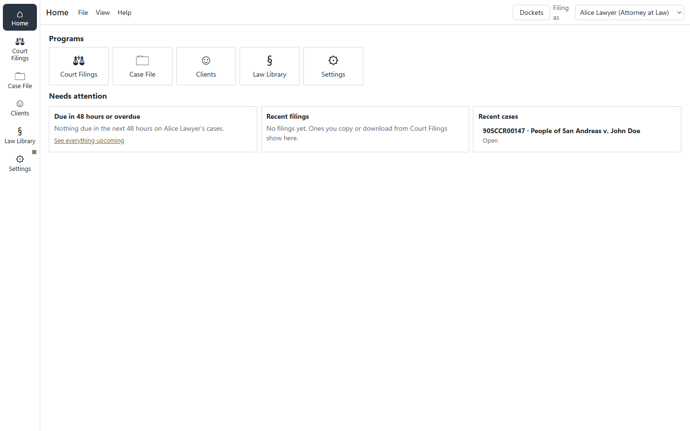
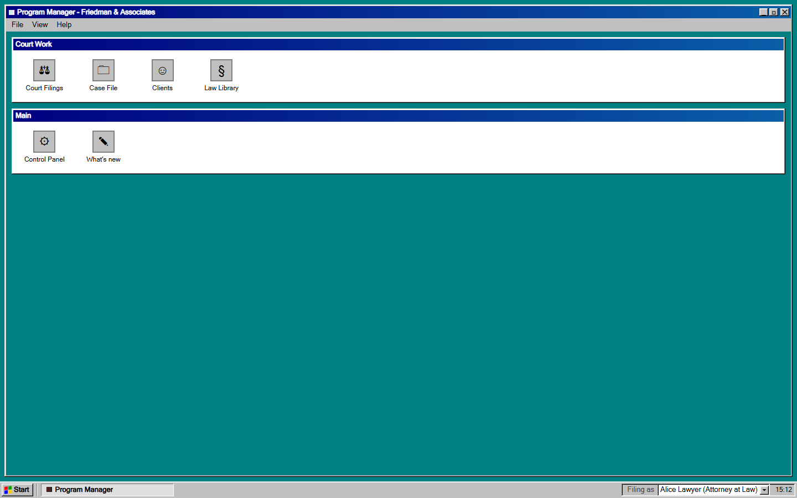

# Court Filing System

[](https://github.com/danieljcode/lawportal-v2/actions/workflows/ci.yml)

A web app for writing San Andreas court filings on a roleplay server, growing into
the office system of the in-game law firm **Friedman & Associates**. Pick a court form, fill it in,
and copy the finished filing straight into the forum editor (as formatted text or BBCode), into
Discord, or download it as a Word `.docx`. Alongside the forms are the firm's own tools: a Case File
with evidence and deadlines, client intake and conflict checks, and a Law Library with the penal
code and the firm's precedents.

It's for Daniel, his friends and the firm's members. It's hosted on Vercel, and it also runs on your
own computer. The firm's name and colours come from one file, `src/branding.ts`; **court forms never carry
firm branding**, so anything posted to the forum looks official. The game is set in 1990, so every
date the app fills in is 36 years before today's real date.

> These are roleplay court forms, not legal documents. Always check a filing before posting it.


## Running it

You need **Node.js 22.6 or newer** (CI uses Node 22; Node 24 works too).

```bash
npm install
npm run dev
```

Then open http://localhost:3000. Only this computer can reach it.

To use it from other devices on your network (only a network you trust):

```bash
npm run dev:lan                     # development, on 0.0.0.0
npm run build && npm run start:lan  # or the production build, on 0.0.0.0
```

Both set **`LAWAPP_ALLOW_LAN=1`**, which lets the app's server answer requests from other machines,
not only `localhost`. Without it, sync and the `.docx` download only work on the computer running the
app. [Development](docs/development.md) has the details and the other settings.

### Hosted (Vercel)

The hosted app is a normal Next.js deploy on Vercel. Vercel's file system doesn't keep writes, so
sync is stored in **Upstash Redis**: set `UPSTASH_REDIS_REST_URL` and `UPSTASH_REDIS_REST_TOKEN` (or
add Vercel's Upstash integration, which sets `KV_REST_API_URL` and `KV_REST_API_TOKEN`), and
`LAWAPP_ALLOW_LAN=1` so the API answers on the site's own address, not only `localhost`. See
[Development](docs/development.md#hosted-on-vercel).

Every pull request gets a preview deploy: Vercel comments its link on the PR. Previews run the real
app with sync switched off, so they never touch real sync data. See
[Previews](docs/development.md#previews).

### npm scripts

| Script                       | What it does                                                                                  |
| ---------------------------- | --------------------------------------------------------------------------------------------- |
| `npm run dev`                | Development server on `127.0.0.1:3000`, with hot reload.                                      |
| `npm run dev:lan`            | The same on `0.0.0.0`, open to your network.                                                  |
| `npm run build`              | Type-checks the app and the tests, and makes a production build.                              |
| `npm start`                  | Serves the production build on `127.0.0.1:3000`.                                              |
| `npm run start:lan`          | The same on `0.0.0.0`, open to your network.                                                  |
| `npm test`                   | Runs every test suite once (Vitest).                                                          |
| `npm run test:e2e`           | Browser smoke tests at desktop and phone sizes (Playwright; builds the app first).            |
| `npm run lint`               | ESLint; fails on any error or warning.                                                        |
| `npm run format`             | Formats every file with Prettier.                                                             |
| `npm run format:check`       | Checks formatting without changing anything.                                                  |
| `npm run port-forms`         | Regenerates `src/data/forms.json` from the reference data (needs access to its private repo). |
| `npm run penal-code`         | Updates `src/data/penal-code.json` from the server's penal code sheet.                        |
| `npm run screenshots`        | Takes screenshots of the running app into `.agents/screenshots/`.                             |
| `npm run screenshots:accept` | Takes the new approved screenshots from the branch's last failed CI run (`docs/testing.md`).  |
| `npm run smoke:preview`      | Checks every form's preview in a browser against the running app.                             |
| `npm run release-notes`      | Prints the release notes for the version in `package.json`.                                   |
| `npm run prepare`            | Runs on `npm install`: turns on the commit-message check in `.githooks/`.                     |

CI runs the tests, lint, the format check, the build, and the smoke, screenshot and accessibility
tests on every push and pull request.

## What's in it

The app is a set of **programs**, shown one at a time. An app rail down the side (a bar along the
bottom on a phone) switches between them, and the top bar shows the program, its **File**, **View**
and **Help** menus, and the character you're filing as, the same in every program. Only the panes
scroll, never the whole page. Switching programs keeps each one's place: the form you were filling
in, your searches and where you'd scrolled to are still there when you come back.



- **Court Filings.** 39 court forms grouped by court (Criminal, Civil, Traffic, Small
  Claims, Appellate, Supreme, general), plus 13 of the firm's own templates: General Petition,
  Petition for Name Change, General Motion, Interrogatories, Subpoena, Service Agreement, four firm
  letters (Engagement, Retainer, Demand, Representation) and three for judges (Ruling on Motion,
  Sentencing Order, Warrant Decision).
  - **Editing:** sections with "x of y filled" counts, required fields, repeatable items, dates on
    the 1990 calendar, Fill from character, Undo and Redo, and Draft history. Drafts save as you
    type.
  - **Output:** a live forum preview with Highlight unfilled; **Copy for forum**, **Copy BBCode**,
    **Download .docx**, and Discord messages split to fit (2,000 characters, or 4,000 with Nitro).
  - **The Form menu:** pick a firm case to fill the form from, open the form's case, insert a
    citation from the Law Library, Draft history and Filing history. Under a text box, **Insert
    exhibit** adds "Exhibit C (Dashcam footage)", which follows the exhibit if it's moved.
- **Case File.** Every firm case with its lead and the characters working it, searchable and
  filterable. Each case has its details, **deadlines and hearings**, the **filings** made for it,
  and its **evidence**: lettered exhibits (A, B, C…) with links and dates, each with a **chain of
  custody** you can copy into a filing or print. **Upcoming** lists the next 14 days, overdue first,
  and the Case File's icon shows a dot when something is due within 48 hours.
- **Clients.** **New client intake** opens a case from one form and prints a client sheet; the
  **Conflict check** looks for a name on either side of every firm case, gives a clear verdict and a
  memo, and keeps a log.
- **Law Library.** The server's **penal code**, browsed by chapter or by title and searched by
  section number, keyword or title, with each charge's class, sentence and fine. The firm's
  **precedents**: rulings with the court, judge, key holding, summary, forum link and topics. Copy a
  citation ("PC 1001 Assault") or insert it into a form.
- **J.A.P.** The Judicial Advancement Portfolio for Court Commissioners I and II: task lists,
  progress and the finished BBCode. Only Court Commissioners see it.
- **Home.** A tile for each program, and what needs your attention: deadlines due in the next 48
  hours or overdue, your latest filings to open again, and the cases you worked on most recently.
- **Settings.** Characters, sync and backups, the Letterhead on firm letters, Appearance (the theme,
  Modern or Classic, and light, dark or system), What's new and About, on one page. The top bar of every program shows who you're filing
  as, with a quick switch, and the sync status.
- **Jump to anything.** Press **Ctrl+K** (**Cmd+K** on a Mac) or **/**, or choose View → Jump to, and
  type a few letters to go straight to a program, a section such as Upcoming or Precedents, or any
  court form.

Prefer the 1990 look? The **Classic (1990) theme** (Settings → Appearance, or View in the menus)
puts the programs in a Windows 3.x window with a taskbar, a Program Manager and a DOS-style startup
screen once per session, with an optional readable font. Light, dark or system is a separate
choice, so it works with either theme. The programs are the same in both; in Classic, Settings is
called the Control Panel.



## Your data and sync

- **Everything is saved in this browser** (IndexedDB). Nothing leaves the computer unless you turn
  on sync.
- **Back up everything** (in Characters) saves one file with your characters, cases, filings,
  drafts and settings, and **Restore backup** puts it back after showing what will change. Damaged
  data is set aside, never deleted, and can be downloaded.
- **Sync** shares your characters (with their J.A.P.), cases, filings, precedents and conflict checks between browsers
  and devices through the app's own server. Turning it on gives you a **sync code**; enter the same
  code on another device to join it. Anyone with the code who can reach the app's server can read
  and change that data, so keep it private.
- **Where the server copy lives:** on the hosted app, in Upstash Redis, one record per code, keyed
  by a hash of the code. Run on your own computer, in one JSON file per code in `data/sync/` (or the
  folder in `LAWAPP_SYNC_DIR`), also named by a hash of the code. `data/` is ignored by Git:
  **never commit sync files**, or anything else with players' data in it.

[Sync, storage and recovery](docs/sync.md) explains how merging and recovery work.

## Project layout

| Folder            | What's in it                                                                                                                                                                                |
| ----------------- | ------------------------------------------------------------------------------------------------------------------------------------------------------------------------------------------- |
| `src/app/`        | The Next.js page, layout and styles, and the server's API routes (`api/account`, `api/data` for sync, `api/docx`).                                                                          |
| `src/shell/`      | The app shell: `App.tsx`, the program registry, routing, both frames (modern and Classic), the home screens, the jump box and the shell's dialogs.                                          |
| `src/programs/`   | One folder per program (`filings`, `cases`, `clients`, `library`, `jap`, `control`), each reached only through its `index.ts`. Court Filings' form inputs are in `filings/fields/`.         |
| `src/ui/`         | Components and hooks shared by the shell and programs: `Dialog`, `ErrorBoundary`, the store hooks (`useStore.ts`) and Filing history.                                                       |
| `src/lib/`        | Everything that isn't interface: the stores (characters, cases, filings…), the template engine (`template/`), form state, Discord and `.docx` output, sync, and `server/` code for the API. |
| `src/data/`       | The court forms (`forms.json`), the firm's templates (`extra-forms.ts`), their index (`form-index.json`), the penal code and What's new.                                                    |
| `src/branding.ts` | The firm's name, short name, logo and colours.                                                                                                                                              |
| `tests/`, `e2e/`  | Vitest suites, and the Playwright smoke tests.                                                                                                                                              |
| `scripts/`        | The npm scripts' code: form porting, the penal code import, smoke checks, release notes, hooks.                                                                                             |
| `docs/`           | Developer documentation.                                                                                                                                                                    |

### First-load budget

Each program's code loads the first time it's opened (and when the browser is idle), so the home screen
downloads only the shell; the court forms' templates come with Court Filings, and the shell lists them from a
small index. **The home screen's first load may download at most 650 KiB of JavaScript** (uncompressed). A
smoke test in `e2e/smoke.spec.ts` measures it on the production build and fails CI above that. It was 1,078 KiB
before LP-122, 892 KiB after it and 612 KiB after LP-133; React and Next.js are about 460 KiB of it. Raise the
budget only on purpose, in the same pull request as the change that needs it.

## Contributing

Work is planned in a private Jira project, **LP**.

- **One issue at a time,** from the top of the board, on its own branch named after it:
  `LP-64-merge-sync-conflicts`.
- **Commits and PR titles** follow `<type>(<area>): <summary> [LP-<n>]`, for example
  `fix(sync): merge conflicts per character [LP-64]`. A hook installed by `npm install` checks this.
- **Never push or merge to `main`.** Open a pull request; Daniel reviews and merges. GitHub doesn't
  enforce this on this plan, so it's up to you.
- **Definition of Done** for every issue: its acceptance criteria met; tests added or updated, all
  passing and CI green; a What's new entry if users will notice; the README and docs updated if setup
  or behaviour changed; and the branch, commits and PR named after the issue, with the PR linking it.

[Contributing](docs/contributing.md) has the full conventions, and [Releasing](docs/releasing.md) the
release steps.

**How to release:** release-please keeps a Release PR open with the next version and `CHANGELOG.md`,
built from the commit messages. To ship a Jira version, merge the Release PR (it tags the version and
publishes the GitHub Release), release the Jira version, then check What's new matches.

## Roadmap

Releases are tracked in Jira versions.

- **v0.2, Stable & focused** (released 19 Oct 2026): tested, one server only, nothing lost.
- **v0.3, Firm tools** (in progress): the Case File, deadlines, intake, conflict checks, evidence,
  the Law Library and the firm's branding, and the app split into programs.
- **v0.4, Office tools:** a Rolodex, Help, Find, the Ledger, and sturdier storage and export.
- **v1.0, Hosted firm:** Discord sign-in, firm workspaces and roles, shared cases, an audit trail
  and Discord reminders.

The direction from v0.3 on is **modern first**: a clean, easy-to-read app, with the 1990 look
becoming an optional **Classic** theme alongside light and dark.

## Documentation

Developer documentation is in [`docs/`](docs/README.md): [development](docs/development.md),
[architecture](docs/architecture.md), [templates and forms](docs/templates-and-forms.md),
[sync](docs/sync.md), [testing](docs/testing.md), [dependencies](docs/dependencies.md),
[contributing](docs/contributing.md) and [releasing](docs/releasing.md).

## Credits

Made by Dan. All rights reserved: see [LICENSE](LICENSE), which also notes the third-party court
forms.
