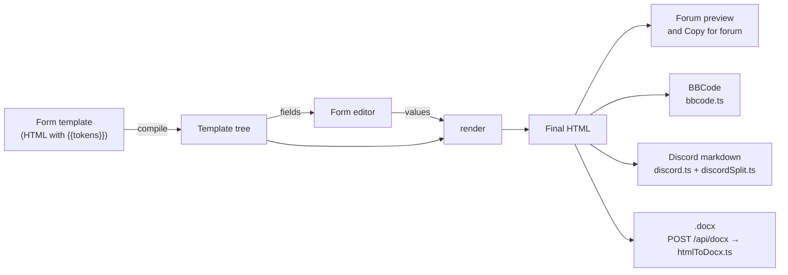

# Architecture

The big picture: what runs where, where data lives, and how a filing gets from a form to the forum.

## Shape of the app

It's a Next.js 15 app (React 19, TypeScript) that runs almost entirely in the browser.

- **One page, client only.** `src/app/page.tsx` renders `AppLoader`, which loads `App` with
  `ssr: false`. The app reads local storage on its first render, so it never renders on the server
  (no hydration mismatches).
- **Hash routing.** `#civil-complaint` opens a form, `#jap` the J.A.P., an empty hash the start
  page. `App.tsx` owns the route, the open dialog and the active character, and remembers the last
  form under `lawapp_last_form`.
- **Three small API routes** on the same server, all behind a host check (see [Server](#server)):
  sync (`/api/account`, `/api/data`) and the `.docx` export (`/api/docx`).

```
src/
  app/            page.tsx (client-only entry), layout.tsx, globals.css, api/{account,data,docx}
  components/     App shell, FormView, dialogs, output panes; fields/ for the form editor inputs
  data/           forms.json (39 court forms, generated), extra-forms.ts (6 templates), changelog.ts
  lib/            the logic: template engine, converters, stores, sync, settings (see below)
  lib/services/   work spanning several stores (characters.ts: delete, duplicate, export, import)
  lib/server/     server-only: host guard, capped body reader, sync codes, file store
scripts/          port-forms, FreestyleRP wording, template safety, release notes, Playwright scripts
tests/            vitest suites, snapshots, the reference-data oracle
```

## From form to filing

Every output starts from one HTML string, so the forum preview, BBCode, Discord and Word all say
the same thing.



1. **Template.** Each form (`src/data/forms.json`, `src/data/extra-forms.ts`) is the forum post's
   own HTML with `{{tokens}}` for the fields. See [Templates and forms](templates-and-forms.md).
2. **Compile and fields** (`src/lib/template.ts`). `compile()` parses the template into a tree;
   `fields()` lists the inputs. `FormView` turns those into the editor (`src/components/fields/`).
3. **Form state** (`src/lib/formState.ts`). Values, prefills (dates, case numbers), filling from
   the active character and dockets, repeatable blocks. Drafts save per form under
   `lawapp_draft_<form id>`.
4. **Render.** `render(tree, values)` produces the final HTML. **Every user value goes through
   `escapeHtml`**, so typed text can never become markup; `tests/xss.test.ts` is the backstop.
5. **Outputs**, all from that HTML:
   - **Forum:** the live preview, and Copy for forum (HTML that keeps tables, with BBCode as the
     plain-text fallback).
   - **BBCode** (`src/lib/bbcode.ts`) for editors that only take plain text.
   - **Discord** (`src/lib/discord.ts`, `discordSplit.ts`, `discordPreview.ts`): markdown split into
     messages of up to 2,000 characters (4,000 with Nitro), never inside formatting or a link.
   - **Word:** the browser posts the HTML to `/api/docx`, and `src/lib/docx/htmlToDocx.ts` builds
     the file on the server. Images become `[Image: <url>]` links; the server never fetches them.

**Dates are in-game.** FreestyleRP is set 36 years back. `src/lib/freestyle.ts` (`gameDate()`) gives
`FormView` its `now`, which feeds Today, Auto, date prefills and the case-number year. Courthouses,
court names and the case-number shape live in `src/lib/courts.ts`.

## Client data: the stores

Everything a user saves lives in the browser's local storage (keys start `lawapp_`):

| Store                             | File                                     | Keys                                 |
| --------------------------------- | ---------------------------------------- | ------------------------------------ |
| Characters                        | `src/lib/characters.ts`                  | `lawapp_chars`, `lawapp_active_char` |
| Dockets (per character)           | `src/lib/dockets.ts`                     | `lawapp_dockets_<character id>`      |
| J.A.P. portfolios (per character) | `src/lib/portfolio.ts`                   | `lawapp_jap_<character id>`          |
| Form drafts                       | `src/lib/formState.ts`, `draftWriter.ts` | `lawapp_draft_<form id>`             |
| Sync state                        | `src/lib/sync.ts`                        | `lawapp_sync_*`                      |

- **KV wrapper** (`src/lib/storage.ts`). The stores never touch `localStorage` directly: they go
  through a small `KV` interface, so tests use `memoryKV()` and a browser that blocks storage falls
  back to memory. `readJson` sets aside values it can't parse instead of deleting them (see
  [Sync, storage and recovery](sync.md#damaged-data)).
- **Change channels and React.** Each store has a change channel with a version counter. The hooks
  in `src/components/useStore.ts` subscribe with `useSyncExternalStore`, so components re-read a
  store when its version moves.
- **Clean on the way in.** Every store runs input through a `clean()` function (trimmed strings,
  known fields only, valid ids), so imports, synced copies and old data can't put odd shapes into
  storage.
- **Stores don't import each other** (LP-3). Work that spans them goes through
  `src/lib/services/characters.ts`: `deleteCharacter` (the character, its docket and its J.A.P.),
  `duplicateCharacter`, and the characters export and import. The one link the other way is
  `touchCharacter` in `storage.ts`: a docket or J.A.P. change bumps its character's `updatedAt` for
  the sync merge, without the stores importing each other.
- **Startup migrations** run once per load in `App.tsx`: the old `lawapp.characters.v1` list, and
  the pre-FreestyleRP `server` field and `lawapp_server` key (LP-71).

## Server

The only server code is three route handlers and `src/lib/server/`:

| Route          | Methods                                                     | What it does  |
| -------------- | ----------------------------------------------------------- | ------------- |
| `/api/account` | `POST` creates a sync code; `DELETE` deletes its data       | Sync accounts |
| `/api/data`    | `GET` the copy; `PUT` replaces it (optimistic, by revision) | Sync data     |
| `/api/docx`    | `POST` HTML, returns a `.docx`                              | Word export   |

- **Host check** (`guard.ts`). Unless the app was started with `dev:lan` / `start:lan` (which set
  `LAWAPP_ALLOW_LAN=1`), every API route answers `421` to requests not addressed to `localhost` or
  `127.0.0.1`. That also stops DNS-rebinding pages reaching the local API.
- **Capped bodies** (`body.ts`). Route handlers have no built-in body limit, so they read through
  `readCapped`: 1 MB for sync data, 2 MB for `.docx`.
- **Sync storage** is one JSON file per sync code: see [Sync, storage and recovery](sync.md).

## Related

- [Development](development.md): setting up and running it.
- [Testing](testing.md): what the suites cover.
