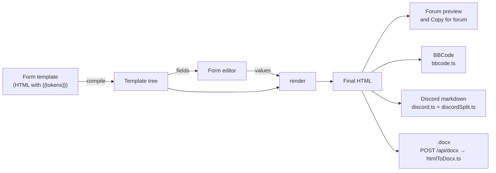

# Architecture

The big picture: what runs where, where data lives, and how a filing gets from a form to the forum.

## Shape of the app

It's a Next.js 16 app (React 19, TypeScript, built with Turbopack) that runs almost entirely in the
browser.

- **One page, client only.** `src/app/page.tsx` renders `AppLoader`, which loads `App` with
  `ssr: false`. The app reads local storage on its first render, so it never renders on the server
  (no hydration mismatches).
- **Branding** (`src/branding.ts`, LP-22). One config holds the firm's name ("Friedman &
  Associates"), short name ("F&A"), the product name ("Court Filing System"), logo, colours and
  wallpaper, so another firm could be set up when it's hosted. The app's chrome reads it: the window
  title and browser tab (`appTitle()`, also `APP_TITLE` in `useRoute`), the toolbar, the favicon
  (`iconHref()`: the logo, or scales in the firm's colours), the boot screen, the crash report and
  Help → About (`AboutDialog.tsx`, the toolbar's **?**). Court forms, the forum preview and
  everything posted stay unbranded; `tests/branding.test.tsx` renders every form to check.
  Changing the firm means editing that file only (the backup format's `BACKUP_APP` id stays).
  The starting tab title is set by a head script (`titleScript()`), not
  Next's `metadata`: Next owned the `<title>` and put it back over the page's own title ("Case File ·
  …") on first load.
- **Boot screen** (`BootScreen.tsx`, `src/lib/boot.ts`, LP-21). `App` draws a DOS-style screen over
  itself, once per browser session (`lawapp_booted` in session storage), unless the start page's
  setting turned it off (`lawapp_boot_screen` = `off`). The app renders underneath at the same
  time and clicks pass through (`pointer-events: none`), so it never holds anything up; any key or
  click ends it, and it ends by itself after 1.8 s (0.7 s on the finished screen with reduced motion).
  It's `aria-hidden`: decoration only.
- **Program Manager** (`ProgramManager.tsx`, LP-104): the Classic layout's home screen (an empty hash). The registry's
  programs as icons in their `group` (Court Work, Main), only those the active character can see,
  plus What's new (a dialog, not a program). Click or Enter opens one; the arrow keys move between
  icons (left and right along the row, up and down to the nearest icon in the next row). Case File's
  icon carries the LP-18 due dot and opens on Upcoming while something is due; What's new shows a
  dot while unread. The taskbar's **Start** returns here. Court Filings with no form open
  (`#filings`) shows the three steps that used to be the start page; the startup screen setting is
  in the Control Panel.
- **Two layouts round the programs** (LP-125). `App.tsx` builds the program, its menus, the set-aside
  notice and the dialogs once, then draws one of two frames, picked by `lawapp_shell`
  (`src/lib/shell.ts`; a temporary setting in the Control Panel and the View menu until the Classic
  theme, LP-112). **Modern** (the default, `ModernFrame.tsx`): an app rail (Home and each visible
  program; a bottom bar at phone width) and a top bar (the program or page name, the `MenuBar`, the
  active character, Characters with the sync dot, What's new, About and the theme). The page never
  scrolls (`.m-app` is fixed to the viewport); only the program's panes do. **Classic**: the Windows
  3.x window, toolbar, taskbar and boot screen described below. Home is the Program Manager in
  Classic and `ModernHome.tsx` in Modern (LP-127): a tile per visible program (linking back to where
  it was left), then "Needs attention": the character's deadlines due within 48 hours or overdue
  (`upcoming(…, SOON_DAYS)`, each linking to its case), the latest 5 filings (opened again through
  App's `openFiling`) and the 5 cases updated most recently, each with an empty state. With no
  character it shows the whole firm's.
- **Jump box** (`JumpBox.tsx`, `src/lib/jump.ts`, LP-128). Ctrl+K (Cmd+K on a Mac) anywhere but
  another dialog (it would replace it, losing what's typed, LP-131), or "/" outside a text field and
  any dialog, opens it (App's keydown listener, `isJumpKey`), as does View →
  Jump to; it's one of `useDialogs`' dialogs, in both layouts. It lists the programs the character
  can see (going back to where each was left), their `sections` from the registry (which are also
  their File menu items) and every court form. `search()` ranks by name: the whole name, its start,
  the start of a word, every typed word starting a word, the name containing it, then the court,
  section or program containing it, then the letters in order; ties go programs, sections, forms.
  The input is an ARIA combobox over a listbox (`aria-activedescendant`), with the result count in a
  live region; Esc or ✕ gives the focus back to where it was.
- **Programs keep their place** (LP-126). Every program opened stays mounted inside React's
  `<Activity>`, hidden while another shows (App remembers each one's last route in `visited`), so
  coming back finds the same form, scroll position, searches and half-typed intake. A hidden
  program's effects are cleaned up (so it does no background work) and come back when it shows;
  only the showing program has `#editor` (`Shell.visible`). The rail and the home screen link
  back to where each was left. Changing the active character drops the hidden programs, so none
  shows the last character's work, and a new page within a program scrolls to the top.
- **Programs** (LP-103). `App.tsx` is the shell: one program at a time, full-screen, in a window
  with its title bar ("Case File - Friedman & Associates"; at home, "Program Manager - Friedman &
  Associates", while the browser tab keeps the LP-22 title), a menu bar (`MenuBar.tsx`: File, View,
  Help, plus each program's own File items), the toolbar, and the taskbar (`Taskbar.tsx`: Start
  returns to the Program Manager, the open program's icon and name, and the tray with the active
  character, the same in every program). The programs are one registry,
  `src/components/programs/registry.ts` (id, title, icon, where it opens, who can see it, whether
  it has a navigation pane, its component); each gets the shell's state and actions as `Shell`
  (`programs/shell.ts`). Court Filings has the court forms (only, since LP-105) as its navigation
  pane (a drawer at phone width) and owns the open form's output. Its **Form** menu (LP-105) holds
  the open form's filing tools: FormView reports them up through `onTools` (`FormTools`: Draft
  history, the Law Library dialog, focus the docket bar's case picker, and the firm case its case
  number matches for Open case in Case File), and Filing history; the buttons in the form stay.
  The Case File (`CaseFileProgram.tsx`, LP-106) has a navigation pane too: All cases, Upcoming
  (with how many are due soon) and the open case, and links across to Clients (New case from
  intake, Run conflict check). A registry entry's `nav` is its pane's id and label, which the
  toolbar's ☰ controls at phone width. Clients (`ClientsProgram.tsx`, LP-107) has a pane too, with
  New client intake and Conflict check, both kept mounted with the other page hidden, so a half-typed intake survives a
  trip to the check. Intake's Run conflict check runs the check (`runConflictCheck`) and hands it
  to the Conflict check page as a request (names, result, `seq`), which fills in the names and
  shows the result; `navigate()` in `useRoute` moves there at once. The Rolodex (LP-30) will be one
  more entry in its pane. The Law Library (`LibraryProgram.tsx`, LP-108) has a pane with Penal Code (All charges, then
  each chapter with its count) and Precedents; a chapter has its own address
  (`#library/penal-code/<chapter slug>`, `chapterSlug`/`chapterFromSlug` in `penalCode.ts`), and
  picking one in the chapter list changes it. `PenalCodeSearch` takes the chapter from the program
  (or keeps its own in the Insert citation dialog, which still shows both as tabs) and can browse
  in section order or by title (`sortCharges`; a search ranks its matches instead). The J.A.P. and
  Control Panel are single-pane for now (LP-109).
- **Hash routing** (`useRoute.ts`). Routes are prefixed by program: `#filings` and
  `#filings/<formId>`, `#cases`, `#cases/<id>` and `#cases/upcoming`, `#clients/intake` and
  `#clients/conflicts`, `#library/penal-code` and `#library/precedents`, `#jap`, `#control`; an
  empty hash is home. `parseHash` also reads the old flat hashes (`#cases`, `#upcoming`,
  `#intake`, `#conflicts`, `#library`, `#jap`, `#<formId>`), and the hook rewrites them to the
  new ones with `replaceState`. The last place is remembered under `lawapp_last_form` as a hash
  without "#" (a bare form id or `jap`/`cases`/`upcoming` from before still reopens).
  `useDialogs` owns the open dialog.
- **Three small API routes** on the same server, all behind a host check (see [Server](#server)):
  sync (`/api/account`, `/api/data`) and the `.docx` export (`/api/docx`).
- **Error boundaries** (`ErrorBoundary.tsx`, LP-88). One wraps the whole app in `AppLoader`; inside
  `App`, the form, the forum preview, the J.A.P. and its output, and each dialog have their own. A
  render error shows an "Application Error" box in that panel's place while the rest keeps working,
  with **Try again** (or **Close** for a dialog), **Reload**, **Download a backup of my data** (the
  LP-1 backup) and **Copy error details**. When the form breaks, its preview is hidden so nothing
  half-made can be copied. The details (`src/lib/crash.ts`) hold the version, where it broke, the
  browser, the error's name and message with quoted text and sync codes blanked out, and code
  locations only, so never a sync code or anything typed into a form. Add a boundary round any new
  major panel.

```
src/
  app/            page.tsx (client-only entry), layout.tsx, globals.css, api/{account,data,docx}
  components/     App shell (useRoute, useDialogs hooks), FormView, dialogs, output panes;
                  fields/ for the form editor inputs
  data/           forms.json (39 court forms, generated), extra-forms.ts (13 templates), changelog.ts
  lib/            the logic: template engine, converters, stores, sync, settings (see below)
  lib/template/   the template engine: parse, prefill, render, escape, plain (template.ts re-exports)
  lib/discord/    HTML → Discord markdown: model, escape, serialize, dom, builder, tables, convert
  lib/formState/  per-form state: state, update, rules, dockets, layout, drafts
  lib/services/   work spanning several stores (characters.ts: delete, duplicate, export, import)
  lib/server/     server-only: host guard, capped body reader, sync codes, file store
scripts/          port-forms, FreestyleRP wording, template safety, release notes, Playwright scripts
tests/            vitest suites, snapshots, the reference-data oracle
```

## From form to filing

Every output starts from one HTML string, so the forum preview, BBCode, Discord and Word all say
the same thing.



1. **Template.** Each form (`src/data/forms.json`, `src/data/extra-forms.ts`) is the forum post's
   own HTML with `{{tokens}}` for the fields. See [Templates and forms](templates-and-forms.md).
2. **Compile and fields** (`src/lib/template/`, re-exported by `template.ts`). `compile()` parses the template into a tree;
   `fields()` lists the inputs. `FormView` turns those into the editor (`src/components/fields/`).
3. **Form state** (`src/lib/formState/`, re-exported by `formState.ts`). Values, prefills (dates, case numbers), filling from
   the active character and dockets, repeatable blocks. Drafts save per form under
   `lawapp_draft_<form id>`.
4. **Render.** `render(tree, values)` produces the final HTML. **Every user value goes through
   `escapeHtml`**, so typed text can never become markup; `tests/xss.test.ts` is the backstop. The
   result is typed `SafeHtml`, and every output below only accepts `SafeHtml`, so the compiler
   rejects HTML that didn't come from a renderer (LP-5, see
   [Templates and forms](templates-and-forms.md#safehtml-the-compiler-checks-it-too-lp-5)).
5. **Outputs**, all from that HTML:
   - **Forum:** the live preview, and Copy for forum (HTML that keeps tables, with BBCode as the
     plain-text fallback).
   - **BBCode** (`src/lib/bbcode.ts`) for editors that only take plain text.
   - **Discord** (`src/lib/discord/`, `discordSplit.ts`, `discordPreview.ts`): markdown split into
     messages of up to 2,000 characters (4,000 with Nitro), never inside formatting or a link.
   - **Word:** the browser posts the HTML to `/api/docx`, and `src/lib/docx/htmlToDocx.ts` builds
     the file on the server. Images become `[Image: <url>]` links; the server never fetches them.

**Dates are in-game.** FreestyleRP is set 36 years back. `src/lib/freestyle.ts` (`gameDate()`) gives
`FormView` its `now`, which feeds Today, Auto, date prefills and the case-number year. Courthouses,
court names and the case-number shape live in `src/lib/courts.ts`.

## Client data: the stores

Everything a user saves lives in the browser's local storage (keys start `lawapp_`):

| Store                             | File                                     | Keys                                 |
| --------------------------------- | ---------------------------------------- | ------------------------------------ |
| Characters                        | `src/lib/characters.ts`                  | `lawapp_chars`, `lawapp_active_char` |
| Cases (the firm's, LP-4)          | `src/lib/cases.ts`; `dockets.ts` (view)  | `lawapp_cases`                       |
| J.A.P. portfolios (per character) | `src/lib/portfolio.ts`                   | `lawapp_jap_<character id>`          |
| Form drafts                       | `src/lib/formState.ts`, `draftWriter.ts` | `lawapp_draft_<form id>`             |
| Draft history (LP-89)             | `src/lib/draftHistory.ts`                | `lawapp_history_<form id>`           |
| Filing history (LP-15)            | `src/lib/filings.ts`                     | `lawapp_filings`                     |
| Conflict check log (LP-10)        | `src/lib/conflicts.ts`                   | `lawapp_conflict_log`                |
| Sync state                        | `src/lib/sync.ts`                        | `lawapp_sync_*`                      |

- **KV wrapper** (`src/lib/storage.ts`). The stores never touch `localStorage` directly: they go
  through a small `KV` interface, so tests use `memoryKV()` and a browser that blocks storage falls
  back to memory. `readJson` sets aside values it can't parse instead of deleting them (see
  [Sync, storage and recovery](sync.md#damaged-data)).
- **Change channels and React.** Each store has a change channel with a version counter. The hooks
  in `src/components/useStore.ts` subscribe with `useSyncExternalStore`, so components re-read a
  store when its version moves.
- **Clean on the way in.** Every store runs input through a `clean()` function (trimmed strings,
  known fields only, valid ids), so imports, synced copies and old data can't put odd shapes into
  storage.
- **Stores don't import each other** (LP-3). Work that spans them goes through
  `src/lib/services/characters.ts`: `deleteCharacter` (the character and its J.A.P., and takes it
  off its cases),
  `duplicateCharacter`, and the characters export and import. The one link the other way is
  `touchCharacter` in `storage.ts`: a J.A.P. change bumps its character's `updatedAt` for
  the sync merge, without the stores importing each other.
- **The shared store base** (`src/lib/store.ts`, LP-2 and LP-99). `createStore<T>(kv, options)`
  handles one saved value: load, validate, save, the change channel and its version counter. The
  options are `key`, `version`, `validate`, `migrations` and `isEmpty` (a value saved as nothing).
  `createKeyedStore<T>` is the same for one value per id under a key prefix (with `prefix` and
  `isId` instead of `key`): each id is read, saved and upgraded on its own, with one change channel
  for the lot. All the data stores are built on them: characters and cases on `createStore`, the
  J.A.P. (`lawapp_jap_<id>`) and draft history on `createKeyedStore`, so none of
  them has its own load, save or change-channel code. (Characters keep a second channel for the
  active character, which isn't saved data.)
  - **Every value carries its schema version**, saved as `{"v": 2, "data": …}`. A bare value (saved
    before its store moved onto the base) reads as version 1; nothing saved is version 0.
  - **Migrations** are a list of steps, each `{ to, up(data, kv), after?(kv) }`. On load, the
    steps from the saved version up run in order. **Reads upgrade in memory and never write**, so
    old data shows correctly even before it's saved again.
  - **`migrate()`** saves the upgraded value and runs each step's `after` clean-up (removing an old
    key, say). It's a no-op once done. Data from a newer version is read as it is and never
    rewritten.
  - **Characters** are at version 2: step 1 brings in the old `lawapp.characters.v1` list when
    nothing's saved (this was `migrateLegacy`), and step 2 wraps the bare array.
  - **The J.A.P.** is at version 2 (LP-99): its only step wraps the bare portfolio.
  - **Cases** are at version 1 (LP-4): with nothing saved, the step turns the old per-character
    dockets (`lawapp_dockets_<id>`, bare or in the LP-99 envelope) into cases and removes those
    keys. Dockets saved before LP-69 keep their GTAW court names and GJ case numbers as filed.
  - **To change a store's shape**, bump its `version` and add a step whose `up` turns the old shape
    into the new one, with a test from the old version.
- **Cases belong to the firm** (`src/lib/cases.ts`, LP-4). A `Case` is the docket fields plus a
  `lead` character, other `assigned` characters, and `created`/`updated` times.
  - **The migration** makes one case per case number (any capitals): the character whose entry was
    updated most recently leads and the others are assigned. Fields come from that newest entry,
    with gaps filled from the others and differing notes kept together. Cases made this way get an
    id from their number (`c90sccr00147`), the same on every device.
  - **A deleted character** is taken off its cases, which stay; a case it led is left with
    `lead: null` (`needsLead`) for someone to take on.
  - **The Case File** (`CaseFileView.tsx`, LP-101) is the program for them: every firm case with
    its lead and others, a search (case number or party) and filters (status, "Needs a lead",
    character), and a case's details and who's on it. `filterCases` and `caseProblem` in
    `cases.ts` do the searching and the checks (a case number no other case has). Areas for linked
    filings, evidence and deadlines are empty until LP-15, LP-12 and LP-18. On a phone the open
    case replaces the list.
  - **The docket bar in forms** (LP-100) lists the firm's cases, the active character's first
    ("<name>'s cases", then "Other firm cases"), loads any of them, and **Save to Case File** updates
    the firm's case with that number (putting the character on it) or adds one with them as lead.
  - **Dockets are a view** (`dockets.ts`): a character's docket is the cases they lead or are
    assigned to, with the `DocketStore` API the Dockets dialog, the docket bar's saving and the
    J.A.P. use. Saving a number the firm already has puts the character on that case; removing one
    takes them off it, deleting it when nobody is left. Only the LP-4 migration reads the old
    `lawapp_dockets_<id>` keys. The pure docket
    fields (`FIELDS`, `clean`, `divisionFor`…) live in `docketFields.ts`, so the two don't import
    each other.
- **Conflict check** (`#clients/conflicts`, `ConflictCheckView.tsx`; `src/lib/conflicts.ts`, LP-10): names (people
  or businesses) against both parties of every firm case and the case notes. Matching ignores
  capitals, punctuation and business suffixes (LLC, Inc…); in the parties, part of a name (3+
  letters) and initials match too, marked partial; in the notes only the whole name. A clear verdict
  ("No conflicts found" / "Possible conflict: review before accepting"), each match's case, side,
  status and lead, and a memo to copy or print. Every check is logged (who, when, the names, the
  result) in `lawapp_conflict_log` (the newest 300), which syncs. `runConflictCheck` in
  `services/conflicts.ts` searches the cases and logs, since it spans two stores.
- **New client intake** (`#clients/intake`, `IntakeView.tsx`; `src/lib/intake.ts`, LP-19): the client's details,
  how they found the firm, the matter, the opposing party, a summary and the urgency. **Open case**
  makes the Case File case: the matter type sets the court and which side the client is on
  (criminal and traffic clients are defendants), the chosen character leads, status is Open, and
  the intake goes in the notes. A blank case number becomes `PENDING-<n>` until the court gives one.
  **Print client sheet** prints just the sheet beside the form (a print stylesheet scoped with
  `:has(#intake-sheet)`). **Run conflict check** checks the client and the opposing party (LP-10).
- **Exhibits** (`src/lib/exhibits.ts`, `CaseEvidence.tsx`, LP-12) live on each case (`exhibits`, in order:
  a title, description, link and in-game date obtained), so they sync and back up with it; a merge
  keeps both copies'. An exhibit's letter comes from its place (A… Z, AA, AB…), so reordering
  relabels them, and anything referring to an exhibit should keep its id, not its letter (LP-13).
  Links are kept only if they're http(s) (`safeLink`), shown with `rel="noopener noreferrer"`, and
  never fetched. The case page's Evidence area adds, edits, reorders and deletes them (after asking),
  each change saved straight away.
- **Exhibit references** (LP-13): a form whose case number is a firm case gets its exhibits
  (`exhibitRefs`). **Insert exhibit** under text fields adds `[Exhibit C: Title #<id>]`; before
  rendering, `resolveExhibitRefs` turns each into "Exhibit C (Title)" by id, with the letter and
  title now, so it's escaped like any other value and works in every output. FormView also
  refreshes the editor's text when the exhibits change (`refreshExhibitRefs`, not an undo step).
  Filing history and draft history previews resolve them against the case as it is now.
- **Chain of custody** (`src/lib/custody.ts`, `ExhibitCustody.tsx`, LP-14) lives on each exhibit
  (`custody`, absent when empty): in-game local time to the minute (`1990-10-20T14:05`, `gameNow`),
  an action (received, reviewed, copied, filed, returned), who (the name at the time, plus the
  character id when it's one of ours) and a note. Kept in time order; the UI only adds entries, and
  editing an exhibit's details keeps its log. A merge keeps every entry from both copies
  (`unionExhibits` → `unionCustody`). Copy for filing renders the list through the template engine
  (`custodyHtml`), so it's SafeHtml with every value escaped; Print renders a sheet only while the
  print dialog is open, shown alone by a `:has(#custody-sheet)` print stylesheet.
- **Penal code** (`src/lib/penalCode.ts`, `PenalCodeSearch.tsx`, LP-17): the Law Library's first tab.
  The charges live in one data file, `src/data/penal-code.json` (title, a note such as "revised
  draft", the source sheet, `updated` and the charges: section, chapter, title, class, default jail,
  min/max range or judge's guidance, fine, description, extra penalties, status). Don't edit it by
  hand: `npm run penal-code` (`scripts/import-penal-code.mjs`) downloads the sheet's Penal Code tab
  as CSV, groups charges under the chapter rows, leaves out the review's notes and stamps today's
  date, which the Law Library shows as "last updated". `searchCharges` puts an exact section
  number first, then title matches, and hides retired charges unless asked or named;
  `sentenceText` words the sentence; `chargeCitation` is "PC 1001 Assault". Insert citation works
  as for precedents.
- **Precedents** (`src/lib/precedents.ts`, `LawLibraryView.tsx`, LP-16): the Law Library's second tab, at
  `#library/precedents`. One list under `lawapp_precedents` (store base, v1, up to 1,000 rulings, newest ruling
  first): case name, number, court, in-game date, judge, summary, holding, an http(s)-only forum
  link (`safeLink`) and lower-case topic tags. Search (`filterPrecedents`) needs every word
  somewhere in the ruling; `highlightParts` splits text for `<mark>`, rendered by React as text.
  Sync merges each ruling by `updated` (`precedent:<id>`); the server takes up to 1,000.
  In a form, focusing a text, textarea, list or paras field registers it (`FormCtx.onFieldFocus`);
  the **Law Library** dialog's Insert citation puts `citation(p)` at that field's cursor, reading
  the field as it is then. Citations are plain text, so they're escaped like any other value.
- **Deadlines and hearing dates** (`src/lib/deadlines.ts`, LP-18) live on each case
  (`deadlines`: an in-game date, a label, a note, done), so they sync and back up with it; merging
  two copies of a case keeps both copies' deadlines. Dates are on the 1990 calendar, as forms fill
  them: "today" is `gameToday()`, from `gameDate()`.
  - **On a case** (`CaseDeadlines.tsx`): add, tick off and remove, each saved straight away. The
    case details form above only reloads when the case's details change, so unsaved edits there
    survive a deadline change.
  - **Upcoming** (`#cases/upcoming`, `UpcomingView.tsx`): the next 14 days on the active character's
    cases (every case with no character), overdue first.
  - **The toolbar dot** on Case File (`dueSoonCount`) shows when something on the active
    character's cases is due within 48 hours or overdue; the button then opens Upcoming.
  - **From a form**: with a firm case for its case number, **Add dates to case** in the case bar
    lists the form's filled-in date fields (`formDates`), with computed ones (a case schedule's,
    `today+21`) and ones named like a hearing or deadline ticked.
- **Filing history** (`src/lib/filings.ts`, LP-15). Each successful Copy for forum, Copy BBCode,
  Discord copy or .docx download keeps a filing: the form, the active character, the case number
  (and the firm case it matched), when and how, and the form's values. Not its HTML: **Copy again**
  renders the values with today's template, which keeps entries small enough to sync. Copying the
  same values again refreshes the newest entry instead of adding one. The newest 150 are kept; if
  storage is full, the oldest go first.
  - **Filing history** (`FilingsDialog.tsx`, from the output pane's status bar) searches by form,
    case number or character, filters by character and case number, and previews a filing.
  - **Use as new draft** on the open form is an undo step (a `draftRequest` to FormView, after
    keeping the current draft in draft history). For another form, App replaces that form's saved
    draft (asking first if it has anything in it, and keeping it in draft history) and opens it.
  - A case's filings (linked to it, or with its case number) show in its **Filings** area in the
    Case File, with the same actions.
- **Undo and draft history** (LP-89). FormView keeps its state in an `Undoable`
  (`src/lib/formState/undo.ts`): every change is an undo step, except that typing in one field
  with pauses under a second joins the last step. Ctrl+Z, Ctrl+Y and Ctrl+Shift+Z work while the
  form (or nothing) has focus. Separately, `draftHistory.ts` keeps snapshots of each form's draft
  on the keyed store: at the session's first edit, then at most every 3 minutes while editing, and
  before Clear form or a restore. Each form keeps the last 20, and the oldest are dropped first if
  storage is full. They're in the full backup but not synced, like drafts.
- **Startup migrations** (`src/lib/migrations.ts`) run once per load, from `AppLoader` after App's
  code has loaded and before it first renders, never during render: each store's `migrate()`, then
  dropping the pre-FreestyleRP `server` field and `lawapp_server` key (LP-71).

## Server

The only server code is three route handlers and `src/lib/server/`:

| Route          | Methods                                                     | What it does  |
| -------------- | ----------------------------------------------------------- | ------------- |
| `/api/account` | `POST` creates a sync code; `DELETE` deletes its data       | Sync accounts |
| `/api/data`    | `GET` the copy; `PUT` replaces it (optimistic, by revision) | Sync data     |
| `/api/docx`    | `POST` HTML, returns a `.docx`                              | Word export   |

- **Host check** (`guard.ts`). Unless the app was started with `dev:lan` / `start:lan` (which set
  `LAWAPP_ALLOW_LAN=1`), every API route answers `421` to requests not addressed to `localhost` or
  `127.0.0.1`. That also stops DNS-rebinding pages reaching the local API.
- **Capped bodies** (`body.ts`). Route handlers have no built-in body limit, so they read through
  `readCapped`: 1 MB for sync data, 2 MB for `.docx`.
- **Rate limits** (`rateLimit.ts`). The sync routes answer `429` when an IP (or the server overall)
  makes too many codes, or an IP sends too many bad codes: see [Sync](sync.md#server-storage).
- **Sync storage** is one JSON file per sync code: see [Sync, storage and recovery](sync.md).

## Related

- [Development](development.md): setting up and running it.
- [Testing](testing.md): what the suites cover.
