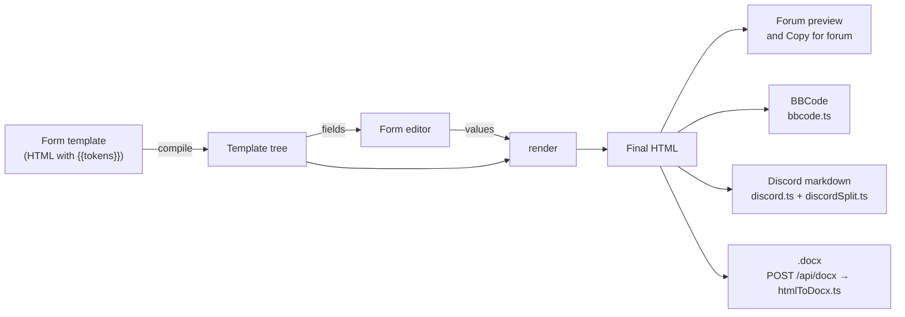

# Architecture

The big picture: what runs where, where data lives, and how a filing gets from a form to the forum.

## Shape of the app

It's a Next.js 16 app (React 19, TypeScript, built with Turbopack) that runs almost entirely in the
browser.

- **One page, client only.** `src/app/page.tsx` renders `AppLoader`, which loads `App` with
  `ssr: false`. The app reads local storage on its first render, so it never renders on the server
  (no hydration mismatches).
- **Hash routing.** `#civil-complaint` opens a form, `#jap` the J.A.P., `#cases` the Case File and
  `#cases/<id>` one case in it (LP-101), `#upcoming` what's due (LP-18), `#intake` the new client intake (LP-19), `#conflicts` the conflict check (LP-10), an empty hash the start page. `useRoute` owns the route and remembers the last form under `lawapp_last_form`;
  `useDialogs` owns the open dialog; `App.tsx` owns the active character and the layout.
- **Three small API routes** on the same server, all behind a host check (see [Server](#server)):
  sync (`/api/account`, `/api/data`) and the `.docx` export (`/api/docx`).
- **Error boundaries** (`ErrorBoundary.tsx`, LP-88). One wraps the whole app in `AppLoader`; inside
  `App`, the form, the forum preview, the J.A.P. and its output, and each dialog have their own. A
  render error shows an "Application Error" box in that panel's place while the rest keeps working,
  with **Try again** (or **Close** for a dialog), **Reload**, **Download a backup of my data** (the
  LP-1 backup) and **Copy error details**. When the form breaks, its preview is hidden so nothing
  half-made can be copied. The details (`src/lib/crash.ts`) hold the version, where it broke, the
  browser, the error's name and message with quoted text and sync codes blanked out, and code
  locations only, so never a sync code or anything typed into a form. Add a boundary round any new
  major panel.

```
src/
  app/            page.tsx (client-only entry), layout.tsx, globals.css, api/{account,data,docx}
  components/     App shell (useRoute, useDialogs hooks), FormView, dialogs, output panes;
                  fields/ for the form editor inputs
  data/           forms.json (39 court forms, generated), extra-forms.ts (13 templates), changelog.ts
  lib/            the logic: template engine, converters, stores, sync, settings (see below)
  lib/template/   the template engine: parse, prefill, render, escape, plain (template.ts re-exports)
  lib/discord/    HTML → Discord markdown: model, escape, serialize, dom, builder, tables, convert
  lib/formState/  per-form state: state, update, rules, dockets, layout, drafts
  lib/services/   work spanning several stores (characters.ts: delete, duplicate, export, import)
  lib/server/     server-only: host guard, capped body reader, sync codes, file store
scripts/          port-forms, FreestyleRP wording, template safety, release notes, Playwright scripts
tests/            vitest suites, snapshots, the reference-data oracle
```

## From form to filing

Every output starts from one HTML string, so the forum preview, BBCode, Discord and Word all say
the same thing.



1. **Template.** Each form (`src/data/forms.json`, `src/data/extra-forms.ts`) is the forum post's
   own HTML with `{{tokens}}` for the fields. See [Templates and forms](templates-and-forms.md).
2. **Compile and fields** (`src/lib/template/`, re-exported by `template.ts`). `compile()` parses the template into a tree;
   `fields()` lists the inputs. `FormView` turns those into the editor (`src/components/fields/`).
3. **Form state** (`src/lib/formState/`, re-exported by `formState.ts`). Values, prefills (dates, case numbers), filling from
   the active character and dockets, repeatable blocks. Drafts save per form under
   `lawapp_draft_<form id>`.
4. **Render.** `render(tree, values)` produces the final HTML. **Every user value goes through
   `escapeHtml`**, so typed text can never become markup; `tests/xss.test.ts` is the backstop. The
   result is typed `SafeHtml`, and every output below only accepts `SafeHtml`, so the compiler
   rejects HTML that didn't come from a renderer (LP-5, see
   [Templates and forms](templates-and-forms.md#safehtml-the-compiler-checks-it-too-lp-5)).
5. **Outputs**, all from that HTML:
   - **Forum:** the live preview, and Copy for forum (HTML that keeps tables, with BBCode as the
     plain-text fallback).
   - **BBCode** (`src/lib/bbcode.ts`) for editors that only take plain text.
   - **Discord** (`src/lib/discord/`, `discordSplit.ts`, `discordPreview.ts`): markdown split into
     messages of up to 2,000 characters (4,000 with Nitro), never inside formatting or a link.
   - **Word:** the browser posts the HTML to `/api/docx`, and `src/lib/docx/htmlToDocx.ts` builds
     the file on the server. Images become `[Image: <url>]` links; the server never fetches them.

**Dates are in-game.** FreestyleRP is set 36 years back. `src/lib/freestyle.ts` (`gameDate()`) gives
`FormView` its `now`, which feeds Today, Auto, date prefills and the case-number year. Courthouses,
court names and the case-number shape live in `src/lib/courts.ts`.

## Client data: the stores

Everything a user saves lives in the browser's local storage (keys start `lawapp_`):

| Store                             | File                                     | Keys                                 |
| --------------------------------- | ---------------------------------------- | ------------------------------------ |
| Characters                        | `src/lib/characters.ts`                  | `lawapp_chars`, `lawapp_active_char` |
| Cases (the firm's, LP-4)          | `src/lib/cases.ts`; `dockets.ts` (view)  | `lawapp_cases`                       |
| J.A.P. portfolios (per character) | `src/lib/portfolio.ts`                   | `lawapp_jap_<character id>`          |
| Form drafts                       | `src/lib/formState.ts`, `draftWriter.ts` | `lawapp_draft_<form id>`             |
| Draft history (LP-89)             | `src/lib/draftHistory.ts`                | `lawapp_history_<form id>`           |
| Filing history (LP-15)            | `src/lib/filings.ts`                     | `lawapp_filings`                     |
| Conflict check log (LP-10)        | `src/lib/conflicts.ts`                   | `lawapp_conflict_log`                |
| Sync state                        | `src/lib/sync.ts`                        | `lawapp_sync_*`                      |

- **KV wrapper** (`src/lib/storage.ts`). The stores never touch `localStorage` directly: they go
  through a small `KV` interface, so tests use `memoryKV()` and a browser that blocks storage falls
  back to memory. `readJson` sets aside values it can't parse instead of deleting them (see
  [Sync, storage and recovery](sync.md#damaged-data)).
- **Change channels and React.** Each store has a change channel with a version counter. The hooks
  in `src/components/useStore.ts` subscribe with `useSyncExternalStore`, so components re-read a
  store when its version moves.
- **Clean on the way in.** Every store runs input through a `clean()` function (trimmed strings,
  known fields only, valid ids), so imports, synced copies and old data can't put odd shapes into
  storage.
- **Stores don't import each other** (LP-3). Work that spans them goes through
  `src/lib/services/characters.ts`: `deleteCharacter` (the character and its J.A.P., and takes it
  off its cases),
  `duplicateCharacter`, and the characters export and import. The one link the other way is
  `touchCharacter` in `storage.ts`: a J.A.P. change bumps its character's `updatedAt` for
  the sync merge, without the stores importing each other.
- **The shared store base** (`src/lib/store.ts`, LP-2 and LP-99). `createStore<T>(kv, options)`
  handles one saved value: load, validate, save, the change channel and its version counter. The
  options are `key`, `version`, `validate`, `migrations` and `isEmpty` (a value saved as nothing).
  `createKeyedStore<T>` is the same for one value per id under a key prefix (with `prefix` and
  `isId` instead of `key`): each id is read, saved and upgraded on its own, with one change channel
  for the lot. All the data stores are built on them: characters and cases on `createStore`, the
  J.A.P. (`lawapp_jap_<id>`) and draft history on `createKeyedStore`, so none of
  them has its own load, save or change-channel code. (Characters keep a second channel for the
  active character, which isn't saved data.)
  - **Every value carries its schema version**, saved as `{"v": 2, "data": …}`. A bare value (saved
    before its store moved onto the base) reads as version 1; nothing saved is version 0.
  - **Migrations** are a list of steps, each `{ to, up(data, kv), after?(kv) }`. On load, the
    steps from the saved version up run in order. **Reads upgrade in memory and never write**, so
    old data shows correctly even before it's saved again.
  - **`migrate()`** saves the upgraded value and runs each step's `after` clean-up (removing an old
    key, say). It's a no-op once done. Data from a newer version is read as it is and never
    rewritten.
  - **Characters** are at version 2: step 1 brings in the old `lawapp.characters.v1` list when
    nothing's saved (this was `migrateLegacy`), and step 2 wraps the bare array.
  - **The J.A.P.** is at version 2 (LP-99): its only step wraps the bare portfolio.
  - **Cases** are at version 1 (LP-4): with nothing saved, the step turns the old per-character
    dockets (`lawapp_dockets_<id>`, bare or in the LP-99 envelope) into cases and removes those
    keys. Dockets saved before LP-69 keep their GTAW court names and GJ case numbers as filed.
  - **To change a store's shape**, bump its `version` and add a step whose `up` turns the old shape
    into the new one, with a test from the old version.
- **Cases belong to the firm** (`src/lib/cases.ts`, LP-4). A `Case` is the docket fields plus a
  `lead` character, other `assigned` characters, and `created`/`updated` times.
  - **The migration** makes one case per case number (any capitals): the character whose entry was
    updated most recently leads and the others are assigned. Fields come from that newest entry,
    with gaps filled from the others and differing notes kept together. Cases made this way get an
    id from their number (`c90sccr00147`), the same on every device.
  - **A deleted character** is taken off its cases, which stay; a case it led is left with
    `lead: null` (`needsLead`) for someone to take on.
  - **The Case File** (`CaseFileView.tsx`, LP-101) is the program for them: every firm case with
    its lead and others, a search (case number or party) and filters (status, "Needs a lead",
    character), and a case's details and who's on it. `filterCases` and `caseProblem` in
    `cases.ts` do the searching and the checks (a case number no other case has). Areas for linked
    filings, evidence and deadlines are empty until LP-15, LP-12 and LP-18. On a phone the open
    case replaces the list.
  - **The docket bar in forms** (LP-100) lists the firm's cases, the active character's first
    ("<name>'s cases", then "Other firm cases"), loads any of them, and **Save to Case File** updates
    the firm's case with that number (putting the character on it) or adds one with them as lead.
  - **Dockets are a view** (`dockets.ts`): a character's docket is the cases they lead or are
    assigned to, with the `DocketStore` API the Dockets dialog, the docket bar's saving and the
    J.A.P. use. Saving a number the firm already has puts the character on that case; removing one
    takes them off it, deleting it when nobody is left. Only the LP-4 migration reads the old
    `lawapp_dockets_<id>` keys. The pure docket
    fields (`FIELDS`, `clean`, `divisionFor`…) live in `docketFields.ts`, so the two don't import
    each other.
- **Conflict check** (`#conflicts`, `ConflictCheckView.tsx`; `src/lib/conflicts.ts`, LP-10): names (people
  or businesses) against both parties of every firm case and the case notes. Matching ignores
  capitals, punctuation and business suffixes (LLC, Inc…); in the parties, part of a name (3+
  letters) and initials match too, marked partial; in the notes only the whole name. A clear verdict
  ("No conflicts found" / "Possible conflict: review before accepting"), each match's case, side,
  status and lead, and a memo to copy or print. Every check is logged (who, when, the names, the
  result) in `lawapp_conflict_log` (the newest 300), which syncs. `runConflictCheck` in
  `services/conflicts.ts` searches the cases and logs, since it spans two stores.
- **New client intake** (`#intake`, `IntakeView.tsx`; `src/lib/intake.ts`, LP-19): the client's details,
  how they found the firm, the matter, the opposing party, a summary and the urgency. **Open case**
  makes the Case File case: the matter type sets the court and which side the client is on
  (criminal and traffic clients are defendants), the chosen character leads, status is Open, and
  the intake goes in the notes. A blank case number becomes `PENDING-<n>` until the court gives one.
  **Print client sheet** prints just the sheet beside the form (a print stylesheet scoped with
  `:has(#intake-sheet)`). **Run conflict check** checks the client and the opposing party (LP-10).
- **Exhibits** (`src/lib/exhibits.ts`, `CaseEvidence.tsx`, LP-12) live on each case (`exhibits`, in order:
  a title, description, link and in-game date obtained), so they sync and back up with it; a merge
  keeps both copies'. An exhibit's letter comes from its place (A… Z, AA, AB…), so reordering
  relabels them, and anything referring to an exhibit should keep its id, not its letter (LP-13).
  Links are kept only if they're http(s) (`safeLink`), shown with `rel="noopener noreferrer"`, and
  never fetched. The case page's Evidence area adds, edits, reorders and deletes them (after asking),
  each change saved straight away.
- **Exhibit references** (LP-13): a form whose case number is a firm case gets its exhibits
  (`exhibitRefs`). **Insert exhibit** under text fields adds `[Exhibit C: Title #<id>]`; before
  rendering, `resolveExhibitRefs` turns each into "Exhibit C (Title)" by id, with the letter and
  title now, so it's escaped like any other value and works in every output. FormView also
  refreshes the editor's text when the exhibits change (`refreshExhibitRefs`, not an undo step).
  Filing history and draft history previews resolve them against the case as it is now.
- **Chain of custody** (`src/lib/custody.ts`, `ExhibitCustody.tsx`, LP-14) lives on each exhibit
  (`custody`, absent when empty): in-game local time to the minute (`1990-10-20T14:05`, `gameNow`),
  an action (received, reviewed, copied, filed, returned), who (the name at the time, plus the
  character id when it's one of ours) and a note. Kept in time order; the UI only adds entries, and
  editing an exhibit's details keeps its log. A merge keeps every entry from both copies
  (`unionExhibits` → `unionCustody`). Copy for filing renders the list through the template engine
  (`custodyHtml`), so it's SafeHtml with every value escaped; Print renders a sheet only while the
  print dialog is open, shown alone by a `:has(#custody-sheet)` print stylesheet.
- **Precedents** (`src/lib/precedents.ts`, `LawLibraryView.tsx`, LP-16): the Law Library at
  `#library`. One list under `lawapp_precedents` (store base, v1, up to 1,000 rulings, newest ruling
  first): case name, number, court, in-game date, judge, summary, holding, an http(s)-only forum
  link (`safeLink`) and lower-case topic tags. Search (`filterPrecedents`) needs every word
  somewhere in the ruling; `highlightParts` splits text for `<mark>`, rendered by React as text.
  Sync merges each ruling by `updated` (`precedent:<id>`); the server takes up to 1,000.
  In a form, focusing a text, textarea, list or paras field registers it (`FormCtx.onFieldFocus`);
  the **Law Library** dialog's Insert citation puts `citation(p)` at that field's cursor, reading
  the field as it is then. Citations are plain text, so they're escaped like any other value.
- **Deadlines and hearing dates** (`src/lib/deadlines.ts`, LP-18) live on each case
  (`deadlines`: an in-game date, a label, a note, done), so they sync and back up with it; merging
  two copies of a case keeps both copies' deadlines. Dates are on the 1990 calendar, as forms fill
  them: "today" is `gameToday()`, from `gameDate()`.
  - **On a case** (`CaseDeadlines.tsx`): add, tick off and remove, each saved straight away. The
    case details form above only reloads when the case's details change, so unsaved edits there
    survive a deadline change.
  - **Upcoming** (`#upcoming`, `UpcomingView.tsx`): the next 14 days on the active character's
    cases (every case with no character), overdue first.
  - **The toolbar dot** on Case File (`dueSoonCount`) shows when something on the active
    character's cases is due within 48 hours or overdue; the button then opens Upcoming.
  - **From a form**: with a firm case for its case number, **Add dates to case** in the case bar
    lists the form's filled-in date fields (`formDates`), with computed ones (a case schedule's,
    `today+21`) and ones named like a hearing or deadline ticked.
- **Filing history** (`src/lib/filings.ts`, LP-15). Each successful Copy for forum, Copy BBCode,
  Discord copy or .docx download keeps a filing: the form, the active character, the case number
  (and the firm case it matched), when and how, and the form's values. Not its HTML: **Copy again**
  renders the values with today's template, which keeps entries small enough to sync. Copying the
  same values again refreshes the newest entry instead of adding one. The newest 150 are kept; if
  storage is full, the oldest go first.
  - **Filing history** (`FilingsDialog.tsx`, from the output pane's status bar) searches by form,
    case number or character, filters by character and case number, and previews a filing.
  - **Use as new draft** on the open form is an undo step (a `draftRequest` to FormView, after
    keeping the current draft in draft history). For another form, App replaces that form's saved
    draft (asking first if it has anything in it, and keeping it in draft history) and opens it.
  - A case's filings (linked to it, or with its case number) show in its **Filings** area in the
    Case File, with the same actions.
- **Undo and draft history** (LP-89). FormView keeps its state in an `Undoable`
  (`src/lib/formState/undo.ts`): every change is an undo step, except that typing in one field
  with pauses under a second joins the last step. Ctrl+Z, Ctrl+Y and Ctrl+Shift+Z work while the
  form (or nothing) has focus. Separately, `draftHistory.ts` keeps snapshots of each form's draft
  on the keyed store: at the session's first edit, then at most every 3 minutes while editing, and
  before Clear form or a restore. Each form keeps the last 20, and the oldest are dropped first if
  storage is full. They're in the full backup but not synced, like drafts.
- **Startup migrations** (`src/lib/migrations.ts`) run once per load, from `AppLoader` after App's
  code has loaded and before it first renders, never during render: each store's `migrate()`, then
  dropping the pre-FreestyleRP `server` field and `lawapp_server` key (LP-71).

## Server

The only server code is three route handlers and `src/lib/server/`:

| Route          | Methods                                                     | What it does  |
| -------------- | ----------------------------------------------------------- | ------------- |
| `/api/account` | `POST` creates a sync code; `DELETE` deletes its data       | Sync accounts |
| `/api/data`    | `GET` the copy; `PUT` replaces it (optimistic, by revision) | Sync data     |
| `/api/docx`    | `POST` HTML, returns a `.docx`                              | Word export   |

- **Host check** (`guard.ts`). Unless the app was started with `dev:lan` / `start:lan` (which set
  `LAWAPP_ALLOW_LAN=1`), every API route answers `421` to requests not addressed to `localhost` or
  `127.0.0.1`. That also stops DNS-rebinding pages reaching the local API.
- **Capped bodies** (`body.ts`). Route handlers have no built-in body limit, so they read through
  `readCapped`: 1 MB for sync data, 2 MB for `.docx`.
- **Rate limits** (`rateLimit.ts`). The sync routes answer `429` when an IP (or the server overall)
  makes too many codes, or an IP sends too many bad codes: see [Sync](sync.md#server-storage).
- **Sync storage** is one JSON file per sync code: see [Sync, storage and recovery](sync.md).

## Related

- [Development](development.md): setting up and running it.
- [Testing](testing.md): what the suites cover.
